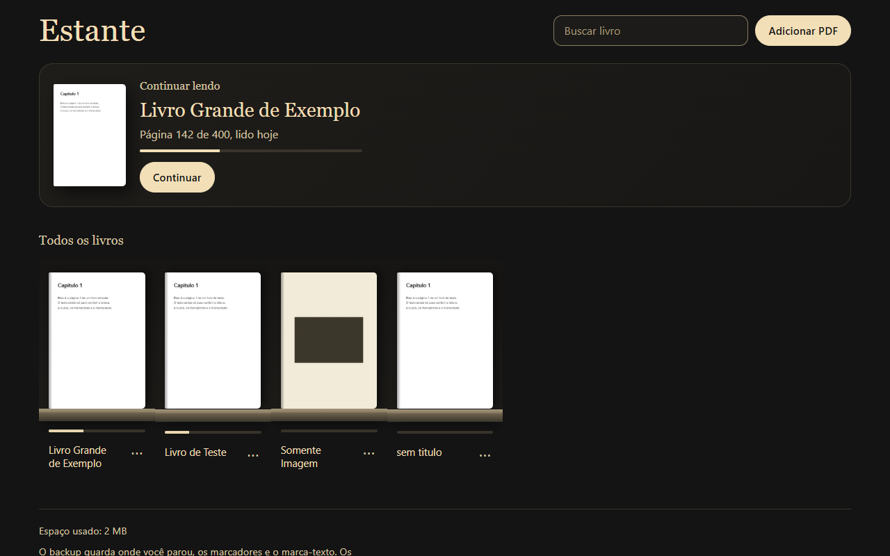
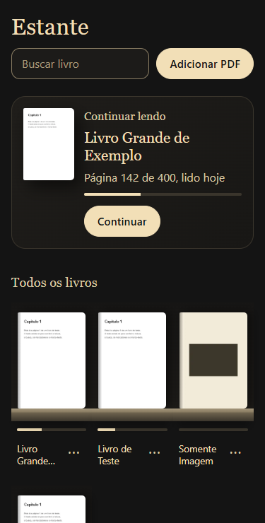
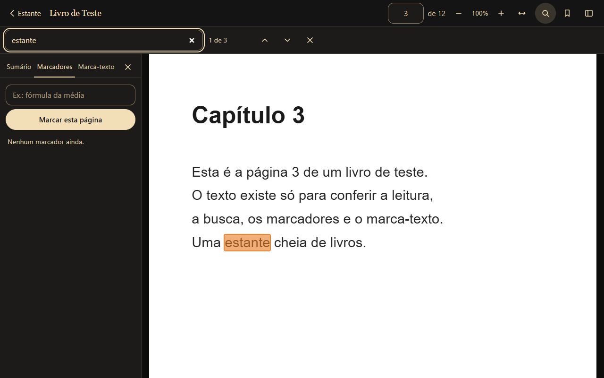

# Estante

Um leitor de PDFs em forma de estante. Os livros ficam com a capa à mostra, cada um abre na página em que você parou, e dá para marcar páginas, pular entre capítulos, buscar no texto e marcar trechos. Funciona no celular, no tablet e no notebook, inclusive sem internet.

**Abrir:** https://whoolv.github.io/estante/

<p>
  
  
</p>

## O que dá para fazer

- **Estante com capas:** a capa de cada livro é a primeira página do PDF, com uma barrinha que mostra quanto você já leu.
- **Continuar lendo:** o último livro aberto fica em destaque e volta direto para a página onde você parou.
- **Sumário lateral:** usa os capítulos do próprio PDF. Se o PDF não tiver sumário, lista as páginas.
- **Marcadores:** marque páginas com ou sem um nome.
- **Busca no livro:** acha a palavra com ou sem acento e mostra cada resultado na página (Ctrl+F).
- **Marca-texto:** selecione um trecho e toque em Marcar. Os trechos ficam listados no painel.
- **Buscar, renomear e remover livros:** pelo campo de busca, pelo botão "⋯", pelo botão direito do mouse ou segurando o dedo na capa.
- **Backup das marcações:** exporte e importe onde parou, marcadores e marca-texto num arquivo `.json`.



## Seus livros ficam só no seu aparelho

Os PDFs, o progresso e as marcações são guardados no navegador do próprio aparelho. Nada é enviado para a internet nem para este repositório. Por isso cada aparelho tem a sua estante: o que você adiciona no celular não aparece no notebook. Para levar as marcações de um aparelho para outro, use **Exportar marcações** e **Importar marcações** no fim da tela inicial, e adicione o mesmo PDF nos dois.

## Como instalar

- **Android (Chrome):** abra o endereço, toque no menu ⋮ e depois em **Instalar app**.
- **iPhone e iPad (Safari):** abra o endereço, toque em **Compartilhar** e depois em **Adicionar à Tela de Início**. No iPhone é importante instalar: fora do app instalado, o Safari pode apagar os dados de sites que ficam dias sem uso.
- **Notebook (Chrome ou Edge):** abra o endereço e clique no ícone de instalar na barra de endereço.
- **Notebook com Windows, como programa:** também há uma versão que abre numa janela própria, com atalho na área de trabalho. Veja [No notebook, como programa](#no-notebook-como-programa).

## Acessibilidade

- Tudo funciona pelo teclado: Tab para navegar, Enter para abrir, setas ou Page Up/Page Down para trocar de página, Ctrl+F para buscar e Esc para fechar painéis ou voltar à estante.
- Os botões têm nomes para leitores de tela, as capas dizem o título e quanto já foi lido, e as mudanças importantes são anunciadas.
- Contraste de cores no nível AA, alvos de toque de pelo menos 44 px e respeito à opção de reduzir movimento.
- Layout testado em celular (320 a 375 px), tablet e computador, inclusive com o texto em 200%.

## Tecnologias

HTML, CSS e JavaScript puros, sem framework. [PDF.js](https://mozilla.github.io/pdf.js/) mostra as páginas, o IndexedDB guarda os livros e um service worker deixa o app funcionar sem internet. Os testes usam Vitest (lógica) e Playwright com axe-core (telas e acessibilidade), sempre com PDFs de teste gerados pelo próprio projeto.

## Rodar no computador

```bash
npm install
npm run servir          # abre em http://localhost:4173
npm test                # testes de lógica
npm run e2e             # testes de tela (usa o Microsoft Edge instalado)
npm run fixtures        # gera de novo os PDFs de teste
npm run icones          # gera os ícones a partir de icons/icone.svg
```

## No notebook, como programa

A pasta `desktop/` tem um lançador em Python que abre a Estante numa janela própria, com o ícone dela e sem precisar de internet. Veja as instruções em [desktop/README.md](desktop/README.md).

## Licenças

O código da Estante usa a licença MIT. O PDF.js, em `vendor/pdfjs/`, é da Mozilla e usa a licença Apache 2.0 (veja `vendor/pdfjs/LICENSE`).
